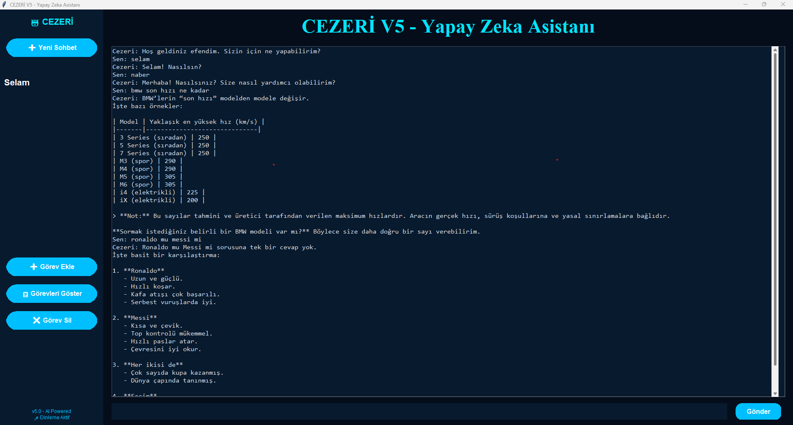

# 🤖 CEZERİ V5

Türkçe konuşan, sesli komutla çalışan yapay zeka asistanı. Özellikle **yaşlı kullanıcılar** düşünülerek, sade ve kısa cümlelerle cevap verecek şekilde tasarlandı.

## ✨ Özellikler

- 🎤 **Sesli komut:** "Cezeri" diyerek konuşmaya başlayabilirsin
- 🗣️ **Sesli cevap:** Türkçe doğal ses (Microsoft Edge TTS, Emel sesi)
- 🧠 **Yapay zeka sohbeti:** Groq API ile her soruya basit ve anlaşılır cevap
- 💬 **Sohbet geçmişi:** Sol panelde birden fazla sohbet, sağ tıkla silme
- ⏰ **Görev ve hatırlatıcı:** "10 dakika sonra ilaç içmemi hatırlat" gibi doğal komutlar
- 📺 **YouTube:** "Cezeri, tarkan şarkısı çal" dediğinde YouTube'da arar
- 💱 **Döviz:** Dolar ve Euro kuru
- 🌦️ **Hava durumu:** Şehir bazlı güncel hava
- 📰 **Haberler:** BBC Türkçe'den son 5 başlık
- 💚 **WhatsApp:** Kişiye mesaj yazma
- 🖥️ **Bilgisayar kontrolü:** Uygulama açma, kapatma, yeniden başlatma

## 🗣️ Örnek Komutlar

| Ne söylersin | Ne olur |
|---|---|
| "Cezeri saat kaç" | Saati söyler |
| "Cezeri dolar ne kadar" | Güncel dolar kurunu söyler |
| "Cezeri Ankara hava durumu" | Ankara için hava bilgisi verir |
| "Cezeri haberleri oku" | Son 5 haberi getirir |
| "Cezeri 15 dakika sonra su içmemi hatırlat" | 15 dakika sonrasına görev ekler |
| "Cezeri Ahmet'e whatsapp merhaba yaz" | WhatsApp'tan mesaj gönderir |
| "Cezeri hesap makinesi aç" | Uygulamayı açar |
| "Cezeri yapay zeka nedir" | Yapay zekaya sorar, basit anlatır |

## 📋 Gereksinimler

- **Windows 10 veya 11** (bazı özellikler Windows'a özeldir)
- **Python 3.10** veya üstü
- Çalışan bir **mikrofon** ve **internet bağlantısı**
- Ücretsiz bir **Groq API anahtarı**

## 🚀 Kurulum

**1. Projeyi indir**

```
git clone https://github.com/KULLANICIADIN/cezeri-v5.git
cd cezeri-v5
```

**2. Kütüphaneleri kur**

```
pip install -r requirements.txt
```

> `PyAudio` kurulurken hata verirse: `pip install pipwin` ardından `pipwin install pyaudio` komutlarını dene.

**3. API anahtarını ayarla**

1. [console.groq.com/keys](https://console.groq.com/keys) adresinden ücretsiz anahtar oluştur
2. `.env.example` dosyasını kopyalayıp adını `.env` yap
3. `.env` dosyasını açıp anahtarını yaz:

```
GROQ_API_KEY=buraya_kendi_anahtarini_yaz
```

**4. Çalıştır**

```
python "Cezeri V5.py"
```

## 🔒 Güvenlik Notları

- API anahtarın sadece `.env` dosyasında durur, **GitHub'a yüklenmez**. Anahtarını kimseyle paylaşma.
- Program sesli komutla **bilgisayarı kapatabilir** ve **klavyeyi otomatik kontrol eder** (WhatsApp ve uygulama açma için). Ortamdaki bir ses yanlış anlaşılırsa istenmeyen işlem olabilir. Sadece kendi bilgisayarında, dikkatli kullan.
- Görevlerin `gorevler.txt` dosyasında yerel olarak saklanır, repoya dahil değildir.

## 🛠️ Kullanılan Teknolojiler

Python, Tkinter, Groq API, Edge TTS, SpeechRecognition, Pygame, PyAutoGUI, Pillow

## ⚠️ Bilinen Sınırlamalar

- Sadece Windows'ta çalışır
- WhatsApp özellikleri için WhatsApp masaüstü uygulaması kurulu olmalı
- Ses tanıma internet gerektirir (Google ses tanıma kullanılır)

## 👤 Geliştirici

[@bellimuhammed863-spec](https://github.com/bellimuhammed863-spec) tarafından geliştirildi.